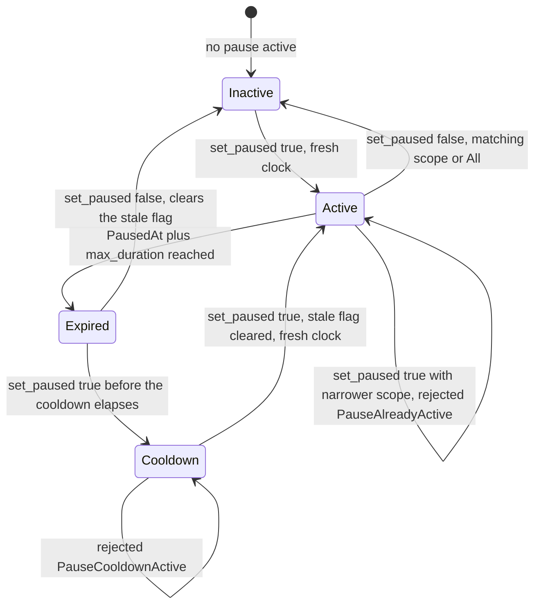

# Escrow Pause Switch — Incident Response Reference

`DataKey::Paused` is a **typed, scoped** operational pause stored in contract
instance storage. It blocks risk-bearing entrypoints for rapid incident
response, records *which flows are affected* (a [`PauseScope`]) and *why*
(a typed [`PauseReason`]), and exposes them via a safe read-only
`get_pause_state()` view. This document describes who can toggle it, how
scopes and reasons work, which entrypoints are gated, how auto-expiry and rate
limiting work, and how the pause relates to the compliance legal hold.

---

## Who can pause

Only the **current** [`InvoiceEscrow::admin`] may call `set_paused`. There is
no secondary role, timelock, or multisig break-glass — production `admin` must
be a governed address (multisig or DAO). This matches the same auth boundary
as [`set_legal_hold`].

```rust
pub fn set_paused(env: Env, active: bool, scope: PauseScope, reason: PauseReason) {
    let escrow = Self::load_escrow_require_admin(&env);
    // rate-limit check, typed storage write, event emission
}
```

---

## Typed reason and scope

Every pause is stored as a [`PauseState`] under `DataKey::PauseState`, written
atomically with the legacy `Paused`/`PausedAt` flags. It records exactly one
`scope` (which flows are blocked) and one `reason` (why). Pausing **one** scope
(`Funding`, `Settlement`, `Withdrawal`, or `Claims`) blocks only that entrypoint
family; pausing `All` blocks every gated entrypoint.

```rust
pub enum PauseScope { Funding, Settlement, Withdrawal, Claims, All }
pub enum PauseReason { Maintenance, Incident, Security, TokenIntegration }
pub struct PauseState { pub scope: PauseScope, pub reason: PauseReason, pub activated_at: u64 }
```

`PauseReason` is a protocol-constant (not free-form) so off-chain consumers and
dashboards can branch on a small, stable set. The compliance/legal hold is a
**separate** mechanism (`DataKey::LegalHold`) and is never represented as a
pause reason.

- `set_paused(true, scope, reason)` activates a scoped pause. Re-pausing an
  already-active pause **never resets the max-duration clock** — it keeps the
  original `activated_at`/`PausedAt` and may only widen the scope (see
  [Re-pausing an active pause](#re-pausing-an-active-pause-max-duration-bypass-prevention)).
- `set_paused(false, scope, reason)` clears the active pause **only** when
  `scope == All` or `scope` matches the active scope. A wrong scope fails with
  `PauseScopeMismatch` (code 246) rather than silently doing nothing, so an
  operator can never believe a pause was lifted when it was not.
- `set_paused(false, All, _)` clears whatever scope is currently active.

### Read-only pause state

`get_pause_state() -> Option<PauseState>` returns the current effective typed
state (`None` when no pause is active, including after auto-expiry). It is a
**pure read**: no auth, no storage mutation, never blocked. `is_paused()`
continues to report just the effective boolean, and `get_pause_state()` is the
view that explains *what* is blocked and *why*.

---

## Gated entrypoints

Gates are **scope-aware**: an entrypoint is blocked only if the active scope
matches its family (`All`, or the matching single scope).

| Function | Scope | Error variant |
|---|---|---|
| `fund` / `fund_with_commitment` / `fund_batch` | Funding | `PausedBlocksFunding` (210) |
| `settle` | Settlement | `PausedBlocksSettlement` (211) |
| `withdraw` | Withdrawal | `PausedBlocksWithdrawal` (212) |
| `claim_investor_payout` | Claims | `PausedBlocksInvestorClaims` (213) |

The check calls `paused_active(&env)`, which:

1. Reads `DataKey::Paused` — returns `false` if absent.
2. Reads `DataKey::PausedAt` — returns `false` if absent (inconsistent state).
3. Reads `DataKey::PauseMaxDuration` — if non-zero, computes `expiry = paused_at + max_duration`. If `ledger.timestamp() >= expiry`, the pause is considered expired (auto-cleared) even if `DataKey::Paused` is still `true`.

Operations that are **not** gated by the pause:

- `get_*` accessors
- `set_paused` itself (admin can always unpause)
- `set_pause_max_duration`, `get_pause_max_duration`, `set_pause_rate_limit`
- `set_legal_hold`, `clear_legal_hold`, `request_clear_legal_hold`
- `record_sme_collateral_commitment`
- `bind_primary_attestation_hash` / `append_attestation_digest`
- `update_maturity`, `update_funding_target`, `propose_admin`, `accept_admin`, `migrate`

---

## How unpausing differs from clearing a legal hold

| Property | Pause (`set_paused`) | Legal hold (`set_legal_hold`) |
|---|---|---|
| Activation | Single admin call | Single admin call |
| Clearing | Single admin call (`set_paused(false)`) | Two-step: `request_clear_legal_hold` + `set_legal_hold(false)` (when delay > 0) |
| Auto-expiry | Optional via `set_pause_max_duration` | None — manual clear required |
| Rate limiting | Configurable via `set_pause_rate_limit` | None |
| Semantic intent | Incident response (e.g. token bug) | Compliance/legal freeze |
| Persistence | Cleared on auto-expiry or admin action | Persists until admin clears |

The pause is designed for **operational** incidents where a quick toggle is
needed. The legal hold is designed for **compliance** scenarios that may require
a mandated cooling-off window before clearing.

---

## Precedence: pause checked first

When **both** `DataKey::Paused` and `DataKey::LegalHold` are active, the
pause gate is evaluated **first** in every gated entrypoint. This means:

- The transaction fails with a `PausedBlocks*` variant (210–213), **not** a
  `LegalHoldBlocks*` variant (102, 120, 123, 125).
- The legal hold error is never surfaced while the pause is active on the same
  entrypoint.
- Clearing the pause (or its auto-expiry) will **then** expose the legal hold
  gate if it is still active.

This ordering is intentional: the operational pause is a faster, more
fine-grained tool for active incidents, while the legal hold is a heavier
compliance lock. The lighter gate fires first to minimise latency during an
incident. See [`escrow-legal-hold.md`](escrow-legal-hold.md) for the full legal
hold reference.

---

## Auto-expiry (`set_pause_max_duration`)

The admin may configure a maximum duration (in ledger seconds) after which the
pause automatically expires:

```
set_pause_max_duration(duration: u64)
  ├─ 0            → no auto-expiry (legacy behaviour)
  ├─ 300 .. 2_592_000 → pause expires after `duration` seconds
  └─ outside bounds → EscrowError::PauseMaxDurationOutOfRange (230)
```

Auto-expiry is read inside `paused_active()`: if `PausedAt + max_duration <=
ledger.timestamp()`, the function returns `false` even though `DataKey::Paused`
is still `true` in storage. The stored flag is **not** automatically cleared —
it is cleared lazily on the next `set_paused(true)` call.

### Re-pausing an active pause (max-duration bypass prevention)

An active pause cannot be extended past its max duration by re-pausing. A
second `set_paused(true, scope, reason)` call while a pause is still effective:

- Keeps the original `PausedAt`/`activated_at` — the max-duration clock is **not**
  reset, so the configured cap always bounds how long the entrypoints stay
  blocked.
- May only **widen** the scope (e.g. `Funding` → `All`). Re-pausing with the same
  scope is accepted as an idempotent no-op (the timestamp is still preserved).
  A **narrower** scope — including a switch between two different single-family
  scopes — is rejected with `EscrowError::PauseAlreadyActive` (code 250) and the
  active pause is left untouched.
- A widening re-pause emits `PausedChanged` with the new scope.

Because the four single-family scopes are mutually incomparable, the only
widening is *family* → `All`.

### Re-activating after auto-expiry (cooldown)

When a pause has auto-expired (`paused_active()` returns `false` while `Paused`
is still `true`), the stale flag and `PauseState` are cleared when the expiry is
noticed during `set_paused(true)`. A fresh `set_paused(true)` then requires:

```
now >= PausedAt + max_duration + cooldown
```

where `cooldown` is configured via `set_pause_cooldown` (defaults to `0`).
Before the cooldown elapses, activation fails with
`EscrowError::PauseCooldownActive` (code 251) and nothing is written; after it
elapses the pause activates with a fresh timestamp.

An explicit `set_paused(false, ...)` is a *deliberate* un-pause, not an expiry:
it clears the pause immediately and does **not** start a cooldown.



### Cooldown configuration (`set_pause_cooldown`)

```
set_pause_cooldown(secs: u64) -> u64
  ├─ 0                     → no cooldown (default)
  ├─ 1 ..= MAX_PAUSE_MAX_DURATION_SECS → cooldown applied after a pause expires
  └─ above the ceiling     → EscrowError::PauseCooldownOutOfRange (252)
```

The cooldown is bounded by the same ceiling as the pause max duration
(`MAX_PAUSE_MAX_DURATION_SECS`, 90 days) so it cannot exceed it. Emits
`PauseCooldownUpdated` with the old and new values. `get_pause_cooldown()` reads
the current value (`0` when unset).

---

## Rate limiting (`set_pause_rate_limit`)

The admin may configure a toggle rate limit to prevent rapid on/off cycling:

```
set_pause_rate_limit(limit: u32, window_secs: u64)
  ├─ (0, 0)        → rate limiting disabled
  ├─ (limit, window) → max `limit` toggles per rolling `window_secs` window
  └─ invalid combo  → EscrowError::PauseRateLimitInvalidCombination (233)
     limit out of bounds → EscrowError::PauseToggleLimitOutOfRange (231)
     window out of bounds → EscrowError::PauseToggleWindowOutOfRange (232)
```

When a rate limit is configured, `set_paused` increments a counter in
`DataKey::PauseToggleCountInWindow`. If the counter reaches `limit` before the
window expires, further toggles fail with
`EscrowError::PauseToggleRateLimitExceeded` (234). The window resets when the
ledger timestamp exceeds `PauseToggleWindowStart + window_secs`.

---

## Configuration functions summary

| Function | Effect | Error if |
|---|---|---|
| `set_paused(active, scope, reason)` | Activate/clear a typed, scoped pause | Rate limit exceeded; re-pause narrow → `PauseAlreadyActive` (250); cooldown active → `PauseCooldownActive` (251); wrong-scope unpause → `PauseScopeMismatch` (246) |
| `set_pause_max_duration(duration)` | Set auto-expiry window | Duration out of bounds |
| `get_pause_max_duration()` | Read current auto-expiry | — |
| `set_pause_cooldown(secs)` | Set cooldown after expiry before re-activation | Cooldown out of bounds → `PauseCooldownOutOfRange` (252) |
| `get_pause_cooldown()` | Read current cooldown | — |
| `set_pause_rate_limit(limit, window)` | Set toggle rate limit | Invalid combination or out of bounds |
| `is_paused()` | Read current pause boolean (effective) | — |
| `get_pause_state()` | Read typed scope + reason (`Option<PauseState>`) | — |

---

## Storage compatibility

`DataKey::PauseState` is an **additive key (ADR-007)**. Instances deployed before
this feature store only the legacy `Paused`/`PausedAt` booleans; on those
instances an active pause without a `PauseState` is treated as
[`PauseScope::All`] — it blocks every gated entrypoint exactly as before. For
new instances the typed `PauseState` is always written, so `get_pause_state()`
returns the exact scope/reason on fresh deployments.

## Incident response procedure

1. **Assess** whether the incident needs an operational pause (quick) or a
   compliance legal hold (timelocked). Refer to the decision tree in
   [`OPERATOR_RUNBOOK.md`](OPERATOR_RUNBOOK.md) §7.
2. **Pause** via `set_paused(true, scope, reason)` — pick the narrowest
   [`PauseScope`] that stops the affected flow (e.g. `Funding`) and a
   [`PauseReason`] that explains why (single admin call, no delay).
3. **Optionally configure** an auto-expiry via `set_pause_max_duration` so the
   pause self-clears after the incident window, and a `set_pause_cooldown` so the
   next pause cannot start immediately afterwards.
4. **Resolve** the underlying incident off-chain.
5. **Unpause** via `set_paused(false)` (or wait for auto-expiry).
6. **If a legal hold was also active:** the gated entrypoints will remain
   blocked with `LegalHoldBlocks*` errors until the hold is cleared via the
   two-step process documented in [`escrow-legal-hold.md`](escrow-legal-hold.md).

> **Note:** re-pausing an active pause does **not** extend it. The max-duration
> clock keeps running from the first activation, and a narrower scope is
> rejected with `PauseAlreadyActive`. To keep a pause running for longer, raise
> `set_pause_max_duration` — never rely on re-pausing.

---

## Test coverage

The matrix in `escrow/src/tests/pause.rs` covers:

1. Default state after `init`: `is_paused()` is `false`.
2. `set_paused(true)` blocks `fund`, `settle`, `withdraw`, `claim_investor_payout`.
3. `set_paused(false)` restores normal operation.
4. Non-admin call to `set_paused` panics with auth failure.
5. Pause is orthogonal to legal hold — both can be active independently.
6. Pause check fires before legal hold check (precedence).
7. Auto-expiry: `set_pause_max_duration` + ledger advancement.
8. `set_pause_max_duration` bounds enforcement (min/max, zero).
9. `set_pause_rate_limit` bounds enforcement.
10. Rate limit blocks excessive toggles.
11. `PauseMaxDurationUpdated` and `PauseRateLimitUpdated` events are emitted on
    configuration changes.
12. `PausedChanged` event is emitted on every toggle and now carries the
    effective `scope` and `reason`.
13. `get_pause_state()` returns `None` when unpaused and the typed `(scope,
    reason)` when paused; it is readable while paused and never blocked.
14. Typed scope/reason edge cases: pause one scope, pause all scopes, unpause
    wrong scope (`PauseScopeMismatch`), already-paused idempotency, and
    unauthorized scoped pause all fail/succeed as documented.

The matrix in `escrow/src/tests/pause_bypass.rs` covers the max-duration
bypass fix (issue #1549):

1. Re-pausing an active pause does **not** extend it: with a 1 h max duration
   and a re-pause at 59 min, the pause still expires at 1 h and funding is
   unblocked at 1 h 30 min.
2. Widening the scope keeps the original `activated_at` and emits
   `PausedChanged` with the new scope.
3. Narrowing (or switching between two single-family scopes) fails with
   `PauseAlreadyActive` and leaves the active pause untouched.
4. Cooldown boundaries: `expiry + cooldown - 1` fails with
   `PauseCooldownActive`, `expiry + cooldown` succeeds with a fresh clock.
5. The stale `Paused` flag and `PauseState` of an expired pause are cleared when
   the expiry is noticed during `set_paused`.
6. With `max_duration == 0` (unlimited) the legacy behaviour is preserved
   (never expires, explicit un-pause clears it, re-activation after an
   un-pause starts a fresh clock) apart from the widen/narrow rule.
7. `set_pause_cooldown` bounds enforcement and admin-only authorization.

---

## Out-of-scope items

| Item | Status |
|---|---|
| Multi-party approval to pause | Out of scope — use a governed `admin` |
| Pause on non-risk-bearing reads | Out of scope — reads are always safe |
| Fee-on-transfer or rebasing tokens | Out of scope — unsupported by design |
| Automatic storage cleanup on expiry | Out of scope — auto-expiry never rewrites `PausedAt`/`Paused`; the stale flag is cleared lazily by the next `set_paused(true)` |
