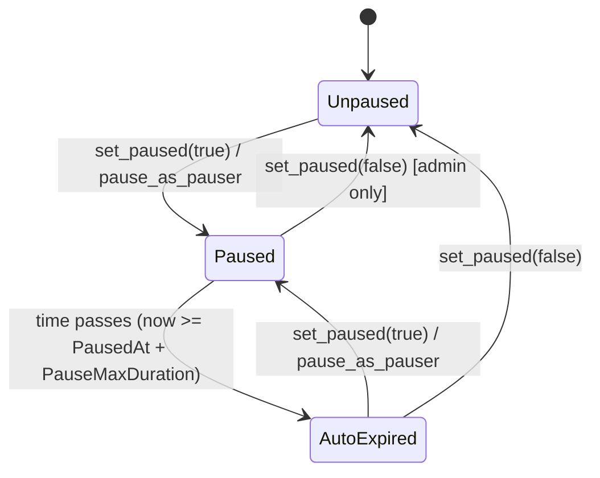

# Operational Pause State Machine

The operational pause (`DataKey::Paused`) is a lightweight incident-response circuit breaker that can be toggled by the `admin`. It is orthogonal to the compliance legal hold and carries no compliance semantics.

An optional, dedicated **pauser** (`DataKey::Pauser`) can also activate a scoped pause immediately, without waiting on a governed multisig. It is deliberately one-way: it can pause but never unpause, and it can change no pause configuration.

## State Diagram

## States

1. **Unpaused**
   - The default operational state where `DataKey::Paused` is `false` or absent.
   - All standard operations and entrypoints are permitted (unless blocked by other gates such as the legal hold).

2. **Paused**
   - The circuit breaker is active (`DataKey::Paused == true`).
   - The state is within the configured max duration window (`now < PausedAt + PauseMaxDuration`). If `PauseMaxDuration == 0`, it does not expire.
   - Critical operations are blocked.

3. **AutoExpired**
   - `DataKey::Paused` is physically `true` in storage, but the pause has surpassed its maximum duration (`now >= PausedAt + PauseMaxDuration`).
   - The contract evaluates this state exactly as **Unpaused**.

## Pauser Transitions

The pauser role (issue [#1548](https://github.com/opratem/Liquifact-contracts/issues/1548)) adds exactly one transition to the machine above: `Unpaused → Paused` (and `AutoExpired → Paused` once the cooldown has elapsed).

| Transition | Trigger | Who |
|---|---|---|
| `Unpaused → Paused` | `pause_as_pauser(pauser, scope, reason)` | The stored pauser only |
| `Paused → Paused` (widen) | `pause_as_pauser(pauser, scope, reason)` with a wider scope | The stored pauser only |
| `Paused → Unpaused` | `set_paused(false, scope, reason)` | **admin only** — the pauser cannot un-pause |

The pauser's transitions go through the same `activate_pause` helper as the admin's, so:

- `PausedAt` (and therefore the max-duration clock) is **never** reset by a pauser re-pause — the
  pauser cannot extend a pause;
- a **narrower** scope is rejected with `PauseAlreadyActive` (250) — the pauser can only widen;
- a re-pause inside the cooldown window is rejected with `PauseCooldownActive` (251);
- the state written and the `PausedChanged { active: 1 }` event emitted are byte-identical to
  those of an admin-initiated pause.

## Enforcing Entrypoints

When the contract evaluates as `Paused` (via the internal `paused_active` predicate), the following entrypoints are blocked, returning their respective typed errors:

| Entrypoint | Error Code | Description |
|---|---|---|
| `fund`, `fund_with_commitment`, `fund_batch` | `PausedBlocksFunding` (210) | Prevents new principal from entering the escrow. |
| `settle` | `PausedBlocksSettlement` (211) | Halts finalizing the escrow. |
| `withdraw` | `PausedBlocksWithdrawal` (212) | Halts SME from withdrawing settled stablecoin. |
| `claim_investor_payout` | `PausedBlocksInvestorClaims` (213) | Prevents investors from claiming payouts on settled escrows. |

**Note on Rate Limiting**: The transition to `Paused` via `set_paused(true)` or `pause_as_pauser` enforces an optional toggle rate limit over a sliding time window to mitigate admin key abuse. Both entrypoints draw from the **same** rolling window and share one combined count, so a pauser cannot bypass a limit configured to protect the admin. Unpausing (`set_paused(false)`) is never rate-limited.

## Pauser Configuration

| Property | Value |
|---|---|
| Storage key | `DataKey::Pauser` (Instance) |
| Type | `Address`, stored as a bare address; absence ⇒ no pauser |
| Default | `None` — `pause_as_pauser` fails with `NotPauser` (254) |
| Setter | `set_pauser(pauser: Option<Address>)` — **admin only** |
| Reader | `get_pauser() -> Option<Address>` — read-only, no auth |
| Event | `PauserChanged { name: "pauser", invoice_id, pauser: Option<Address> }` |
| Role conflicts | The SME address and the treasury address are rejected with `PauserRoleConflict` (253) |

The pauser may **not** change any pause configuration: `set_pause_max_duration`,
`set_pause_cooldown`, and `set_pause_rate_limit` all remain admin-only, and `set_pauser` itself
is admin-only so a pauser can never appoint a successor or revoke itself.

See also: [`docs/pause-auth.md`](pause-auth.md).
